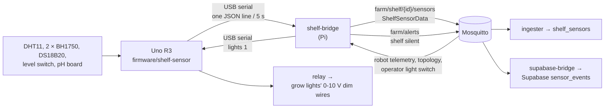

# Shelf sensors

One sensor node watches the shelf's air and hydroponic reservoir. It's an
Arduino Uno R3 on USB to the Pi: no WiFi, no clock, no shelf identity. The
Pi's `shelf-bridge` service gives each reading its shelf, pH and timestamp and
publishes it like any other farm message.

## Hardware

| Part | Measures | `ShelfSensorData` field |
|---|---|---|
| DHT11 module (blue, 3 pins) | Air temperature, humidity | `temperature_c`, `humidity_pct` |
| BH1750 / GY-302 board, bottom level | The bottom level's grow light | `lights` (its level from `light_levels`) |
| BH1750 / GY-302 board, top level (ADDR to 3.3V) | The top level's grow light | `lights` |
| DS18B20 steel probe | Reservoir water temperature | `water_temp_c` |
| DFRobot liquid level kit: XKC-Y25-V contactless switch (white disc) + adapter | Reservoir above/below a line | `water_level_ok` |
| pH electrode + DFRobot pH meter V1.1 board | Reservoir pH | `ph` |

Wiring is in [wiring/shelf-sensor.md](wiring/shelf-sensor.md), the serial
line format in
[firmware/shelf-sensor/README.md](../firmware/shelf-sensor/README.md). The
previous team's DS1307 RTC isn't used: the Pi timestamps readings on receipt
(there is no clock sync, by design).

**Mounting**

- **Level switch:** tape or clip it to the outside of the reservoir at the
  lowest acceptable water line. It senses through plastic or glass up to about
  20 mm thick, not through metal.
- **DS18B20 and pH probe:** submerged in the reservoir, away from the pump
  outlet. Never let the pH bulb dry out; store it capped with its storage
  solution.
- **BH1750s:** one per level, at plant height, facing that level's grow
  light and out of the other level's. The bottom one is on the perfboard; the
  top one is on a cable of up to about 800 mm, sharing the I2C bus
  ([wiring](wiring/shelf-sensor.md#top-level-light-sensor)).
- **DHT11:** in the canopy air, out of direct light and away from the water.

## Running it on the Pi

1. Flash the Uno once: `cd firmware/shelf-sensor && pio run -t upload`.
2. Plug it into the Pi and find its stable path: `ls /dev/serial/by-id/`
   (`/dev/ttyACM0` works too, but can change if other USB serial devices are
   added).
3. On the Pi it runs as the `farm-shelf-bridge` service
   ([PI-SERVICES.md](PI-SERVICES.md)). Its config is
   `/etc/verdant/shelf-bridge-config.json`, copied from
   `farm-controller/shelf-bridge-config.json` and kept outside the repo,
   because the port and pH calibration belong to that Pi. Put the
   `/dev/serial/by-id/...` path in `port` there.
4. Watch the readings with `mosquitto_sub -t 'farm/shelf/#' -v`.

On a laptop, `npm run shelf` runs it against the repo's config (your user
needs to be in the `dialout` group to open serial ports).

### Config (`shelf-bridge-config.json`)

| Key | Meaning |
|---|---|
| `shelves[].shelf_id`, `level` | Identity the readings are published under |
| `shelves[].port` | Serial device of that shelf's node |
| `shelves[].ph_neutral_mv`, `ph_mv_per_unit` | pH calibration (below) |
| `shelves[].light_levels` | Level each of the node's light sensors faces, in its order (bottom sensor, then top): `[0, 1]`. Left out, the node has one, at the shelf's `level`. Each reading is published as `lights: [{ "level": 0, "lux": 412 }, …]` |
| `silence_timeout_ms` | No valid reading this long → one alert, resolved by an info alert when readings resume |
| `reopen_interval_ms` | Retry delay for a missing or dropped port |
| `baud`, `max_line_length`, `watchdog_interval_ms` | Serial and timing settings |
| `lights.shelf_id` | The shelf whose node has the light relays. Leave `lights` out for no grow light control |
| `lights.levels` | The level each relay channel switches, in order: `[0]` is D5 for level 0 (`[0, 1]` adds D6 for level 1). At most two, the node's relays. The dashboard shows a switch per level |
| `lights.follow_robots` | `true`: each level is lit only while a robot is on it (or riding the elevator to it); needs a relay per level, so with one level in `levels` it's ignored (logged at start). `false` or left out, the default: every level is lit until all the robots are docked |

## Grow lights

The grow lights are on unless the robots are all parked on the dock, or the
operator has switched them off on the dashboard. The node switches them
through relays (Adafruit #4409) on D5 and D6, wired across the lights' 0–10 V
dim wires ([wiring](wiring/shelf-sensor.md#grow-light-relays)); the bridge
decides. Each relay is given a level in `lights.levels` and the dashboard
shows a switch per level. The farm has one light supply for both levels, so
the config lists only level 0: the relay on D5 switches every light, and the
dashboard shows a single "Level 1" switch. Wiring a second supply to the D6
relay and adding `1` to `levels` adds a "Level 2" switch. (The dashboard and
map count levels from 1 for the operator; the topology's `z`, `levels` and
`light_levels` count from 0, so level 0 is "Level 1" / L1.)

**Setting it up**

1. Wire the relay and check the lights turn fully off with their dim wires
   shorted ([wiring](wiring/shelf-sensor.md#grow-light-relays)).
2. Reflash the shelf node (`cd firmware/shelf-sensor && pio run -t upload`):
   firmware from before the lights ignores the bridge's lines.
3. Copy the `lights` block from the repo's `shelf-bridge-config.json` into
   `/etc/verdant/shelf-bridge-config.json` (a deploy never changes that
   file), set its `shelf_id` and `levels`, and
   `sudo systemctl restart farm-shelf-bridge`. A config from before the
   operator switch works as it is; its `robot_timeout_ms` is no longer used.
4. Check `journalctl -u farm-shelf-bridge -n 20` shows
   `[LIGHTS]  levels 0 by shelf-1's relays`, then drive a robot onto and
   off the dock.

**When they're on**

- **Robots docked: off.** A robot reaching the dock (its `current_node` is a
  dock node in the topology) turns every level off once every robot is there.
  They come back on as soon as one drives off: a robot on its dock tag that's
  `en_route` counts as leaving. The robot is the source of truth: it's where
  its last tag says.
- **The operator's switch.** On FarmNet the dashboard's **Lights** card
  has an On/Off switch per level. Off keeps that level's lights off whatever
  the robots do; On lets them follow the robots again. The remote dashboard has no
  switch, like jog. Switches live in the bridge's memory: a bridge restart or
  Pi reboot switches every light back on.
- **Per level (`follow_robots: true`).** With a supply per level (D5 and D6,
  `levels: [0, 1]`), each level is lit only while a robot is on it: the level
  of the last tag it read (the node's `z`). Riding the elevator, it also lights
  the level it's riding to, from the elevator tag it rides from, so that level
  is lit when it drives off; the bridge works out the ride's end with the same
  shortest path the robot computes, to its task's target (the orchestrator's
  retained `farm/robot/{id}/state`) or, returning, to the dock. A ride through
  several levels lights only the last. A stopped robot doesn't look ahead. The
  dashboard says "Off: no robot on this level" for a level waiting for one.
  Off (the default), every level is lit while any robot is out.
- A robot that goes **silent** stays where it last was: only reaching the dock
  turns the lights off, so a robot out of WiFi on a level keeps them on (per
  level: its level).
- A robot whose place can't be told, one that **hasn't read a tag** since it
  booted or reports a node the topology doesn't have, lights every level.
- With **no robot heard from** yet (the bridge just started), or before the
  orchestrator's topology says where the dock is, the lights stay on.

The bridge sends the node `lights 10` (one `1` on or `0` off per relay) when
that changes, and again with every reading, so a lost line or a node that
reset is put right within one report (5 s). It also publishes each light's
switch and state per level, retained, on `farm/lights/state` for the dashboard. It logs
each change: `[LIGHTS] lights 0 (robots docked)`, and each switch:
`[LIGHTS] level 1 switched off by dashboard`.

**Failures leave the lights on**, never off: the plants keep their light.

| Failure | Lights |
|---|---|
| Uno unpowered, resetting or unplugged | All on (relays released) until the bridge resends, within a few seconds of it printing again |
| Bridge stopped, or the Pi off | All on, 30 s after the last line it got (the node's `LIGHTS_TIMEOUT_MS`) |
| Broker down | The bridge can't hear the robots or the operator, so it stops sending: all on 30 s later |
| Orchestrator not running at the bridge's start | On until its retained topology says where the dock is. Once loaded, the bridge keeps it |
| A robot powered off or out of WiFi | Stays where it last was: off only if that was the dock (per level: its level stays lit) |
| Orchestrator not running, so no task target (per level) | Only the elevator look-ahead is affected: the new level comes on at its first tag instead of during the ride |

**Turning it off for the demo or a test:** switch the lights On on the
dashboard, or remove `lights` from `/etc/verdant/shelf-bridge-config.json` and
restart the bridge; the node's lights go back on 30 s later.

## pH calibration

The bridge converts the board's output with
`pH = 7 + (ph_mv − ph_neutral_mv) / ph_mv_per_unit`, so calibrating is editing
two numbers; the Uno is never reflashed. Stop the bridge first (only one
program can hold the port) and read `ph_mv` with `pio device monitor`.

**Without buffer solutions (offset only, about ±0.5 pH):**

1. Unplug the probe and short the BNC socket's centre pin to its outer shell
   (a paperclip works). That's what the board sees at pH 7.
2. Wait for `ph_mv` to settle (about 2000) and put it in `ph_neutral_mv`.
3. Leave `ph_mv_per_unit` at the typical 286.

**With pH 7 and pH 4 buffers (accurate):**

1. Rinse the probe, put it in pH 7, wait a minute, note `ph_mv` as *mv7*.
2. Rinse, put it in pH 4, wait, note *mv4*.
3. Set `ph_neutral_mv` = *mv7* and `ph_mv_per_unit` = (*mv7* − *mv4*) / 3.
   It comes out positive on this board (the voltage rises with pH), about 286
   unless the board's gain potentiometer has been turned.

Restart the bridge after editing the config: `sudo systemctl restart farm-shelf-bridge`.

## What happens when things fail

| Failure | Node | Bridge / data |
|---|---|---|
| One sensor unplugged or dead | Logs `# <sensor> failed` once, prints `null` for it | Publishes `null`; other readings unaffected |
| pH board or probe unplugged | Reports whatever A0 floats to | pH outside 0–14 becomes `null` |
| Level switch unplugged | The pull-down reads it as "low" | `water_level_ok: false`, the safe direction |
| Light sensor reset by a power glitch | Re-sends its mode every report, so at most one wrong reading | — |
| Top light sensor unplugged or its cable loose | Logs `# bh1750 top failed`, prints `null` for it | Its level's `lux: null`; the map shows that level with no reading |
| A light sensor or its cable holding the I2C bus low | Both light sensors share the bus. At its next report the node clocks the bus free (logs `# i2c bus was stuck, cleared`) and configures both again: about two reports of `null` | Both lights `null` meanwhile; the other readings unaffected |
| A light sensor locked up so it holds the clock line too | The node can't clear it: logs `# i2c bus stuck, can't clear it` once, keeps reporting the rest | Both lights `null` until the Uno is power-cycled (unplug its USB) |
| Top sensor's ADDR wire broken or on row 11 | Both sensors answer at 0x23: the bottom reading wrong with no error | The top level's `lux: null`; check ADDR before trusting the bottom one |
| Firmware from before the top light sensor | One `light_lux` number | Published as the first level's; the others `null` |
| `light_levels` left out of the Pi's config | — | Only the bottom sensor is published, at the shelf's level: add `light_levels` |
| Node hangs (I2C, firmware bug) | Watchdog resets it within 8 s | Logs the restart (`seq` went back) |
| Port open but silent (node hung past its watchdog, wedged USB) | Reset by the reopen (DTR) | After 20 s closes and reopens the port, and keeps doing so every 20 s until readings return |
| USB unplugged / node rebooting | — | Reopens the port every 3 s; one alert after 20 s of silence; when readings resume, logs it and publishes an info alert resolving it |
| Pi reboots or loses power | Powered by the Pi's USB, so it restarts with it | systemd starts the bridge; it waits for the port and broker, readings resume within about 10 s. A silence alert still open from before resolves on the first reading (it's saved in `STATE_PATH`) |
| Pi clock jumps (no RTC; NTP syncs late or never) | — | Silence is timed on a monotonic clock, so no false alerts; published `timestamp` follows the Pi's clock like every other service |
| Garbage, partial or library error lines | — | Never published; non-JSON lines are logged as node output, repeats once |
| Broker down | — | The shared MQTT client reconnects and sends readings queued while it was offline |

The readings reach the dashboard two ways: on FarmNet straight from
`farm/shelf/+/sensors` over MQTT, and remotely through the Supabase bridge,
which mirrors them into Supabase's `sensor_events` table
([SUPABASE-SETUP.md](SUPABASE-SETUP.md)). On FarmNet the dashboard shows the
newest reading of any shelf; the remote path waits on the Supabase bridge.

The Light card and History page show each level's light. On FarmNet the farm
map draws each level's grow light from the Lights card's switches by default:
fully on or off, a level without its own switch following whether any light
is on. With `NEXT_PUBLIC_MAP_LIGHTS_FROM_SWITCHES=false` in `dashboard.env`,
and on the remote dashboard (no switches there), it draws them from the light
sensors instead: as bright as the reading for that level (its `level` is the
topology's `z`), in proportion up to `FULL_GLOW_LUX` in
`web/src/lib/farm/map/renderer.ts` (5000 lux), or with
`NEXT_PUBLIC_MAP_LIGHTS_ON_OFF=true` simply on at `ON_OFF_LUX` (2000 lux) or
more and off below. Set `FULL_GLOW_LUX` to what a sensor reads under its light
at full brightness. A level with no current reading
(none in the last 10 s, the sensor `null`, or no sensor faces it) is drawn as
off, never as lit; its tooltip says "no reading".
This assumes one shelf node, as on this farm: with several, the card and map
show whichever reported last.
