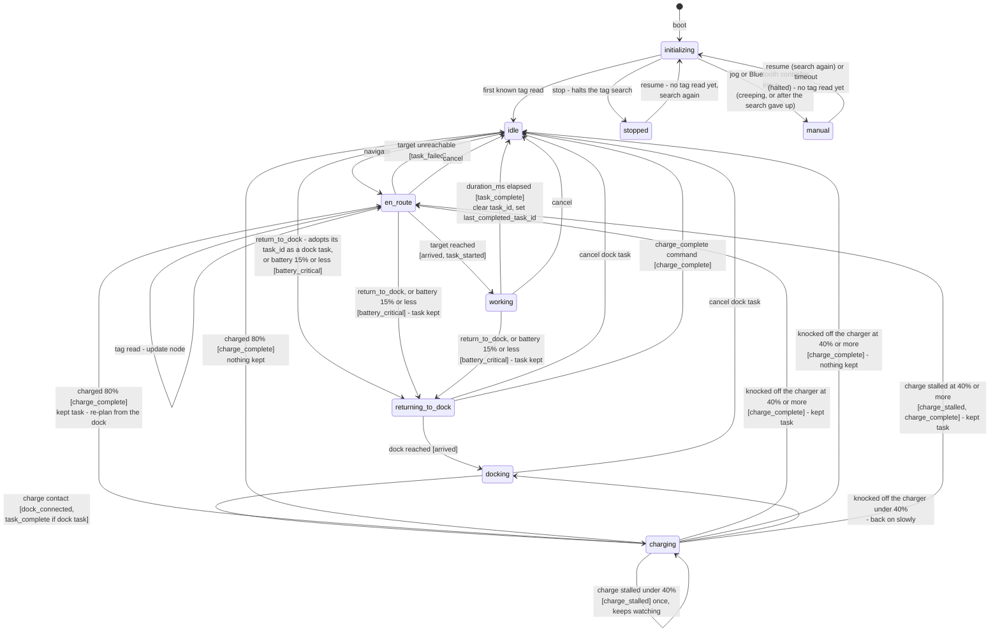
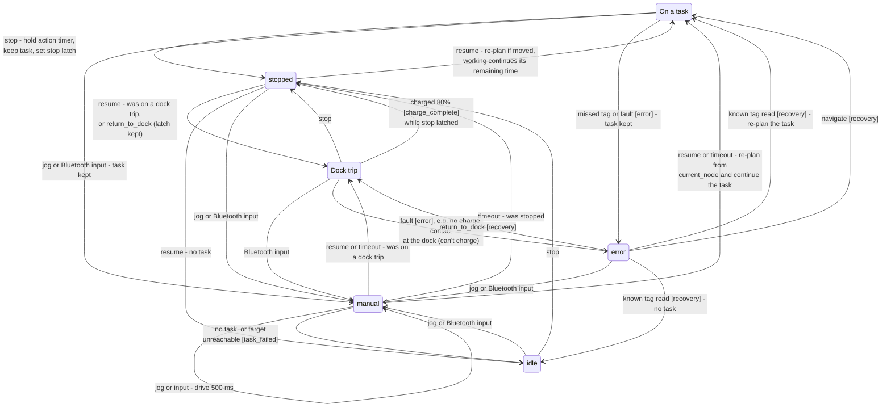

# Robot firmware state machine (intended)

The navigation task's state machine, as specified in
`docs/firmware-architecture.md`. The states are the `status` values the robot
reports in telemetry. The simulator (`farm-controller/simulator`) implements the
same behaviour and is the reference when in doubt.

Events are shown in `[brackets]` and are always pushed **before** the status
changes (comms publishes queued events before telemetry). Thresholds are the proposed `config.h` values.

## 1. Normal operation

## 2. Interrupts: stop, manual, faults

"On a task" is `en_route` or `working`; "Dock trip" is `returning_to_dock`,
`docking` or `charging`.

## Rules the diagram can't show

- **Before the first tag** (`initializing`, or `stopped` / `manual` reached
  from it) the robot only accepts `stop`, `resume` and jogs (the dashboard's
  and the Bluetooth controller's); everything else is ignored.
  Leaving that `stopped` or `manual`, a robot that read a tag meanwhile goes
  `idle`; otherwise it goes back to `initializing`, searching again on
  `resume` and halted after a manual timeout (so it never drives off a bench
  on its own). `resume` in a halted `initializing` restarts the search.
- **`navigate`** is accepted in any state after `initializing`. It replaces the
  task, clears the stop latch, paused status and kept task, and goes to
  `en_route`. It is ignored if its `task_id` equals the current task or
  `last_completed_task_id` (a redelivered duplicate).
- **`cancel`** only acts on a matching `task_id`. It clears the task without
  setting `last_completed_task_id` or sending an event. A cancelled task that was
  paused by `stop` leaves the robot `stopped` (it resumes to `idle`). Cancelling a
  task kept during a dock trip leaves the trip running, so the robot still
  charges.
- **`return_to_dock`** is ignored while already returning, docking or charging
  (a bench charge, below, excepted).
- **`CHARGE_SENSE_ALWAYS`** (bench tests, `config.h`): the charge contact
  closing while `idle` or `stopped` sends `dock_connected` and goes `charging`
  where the robot is. Any way the charge ends (`charge_complete`) goes back to
  that `idle` or `stopped`, its paused task and stop latch kept (a `resume`
  while charging releases it as usual). A `stop` or manual control meanwhile
  comes back to `charging` there, never driving to the dock; `navigate` and
  `return_to_dock` replace it. With the flag on, losing the contact while
  `charging` (bench or dock) always ends the charge instead of backing onto
  the dock.
- **`stop`** is accepted in any state, `initializing` included (the diagram
  shows the common ones), and ignored when already `stopped`. `resume` returns to the
  paused state, re-planning first if the robot was moved.
- **`resume`** outside `manual` only acts if the stop latch is set. In `manual`
  it also clears the latch.
- **Manual timeout:** each jog drives for 500 ms, and each Bluetooth stick
  input for 250 ms at a speed from the stick. Each restarts a 5 s timer
  (`MANUAL_TIMEOUT_MS`); when it runs out the robot leaves manual as shown.
- **Stop latch:** set by `stop`, cleared by `resume` or `navigate`. It survives
  dock trips and manual timeouts.
- **`idle` never holds a task:** `task_id` is `null` in `idle`. In every other
  state the robot keeps its `task_id` until the task completes, fails or is
  cancelled.
- **Survival overrides** run before everything else, except that in `stopped`
  and `manual` only the motor cutoff (about 5%) applies: a stop beats the
  forced return.
  - warn at 20% [`battery_low`];
  - forced return at 15% [`battery_critical`], keeping the task; once per
    drop, again after reaching the charger or rising above 20%;
  - motor cutoff at about 5%, until back above 15%. Driving itself with the
    motors cut off is a fault [`error`].
- **Obstacle:** motors stop (easing off over `STOP_RAMP_MS`) while the flag
  on the side they're driving toward is set (front or rear sensor). The status
  doesn't change. After the elevator or dock tag, the robot creeps in closer
  than that instead (ToF approach). `[obstacle_detected]` is sent once, then
  `[path_blocked]` if still blocked after a timeout. In `manual` the motors
  stop the same way, and the events are sent when a jog runs into the
  obstacle.
- **Telemetry** is sent every 1 s and on every status or node change, and always
  reports the current `task_id` and `last_completed_task_id`. The robot never
  reports `lost`.
