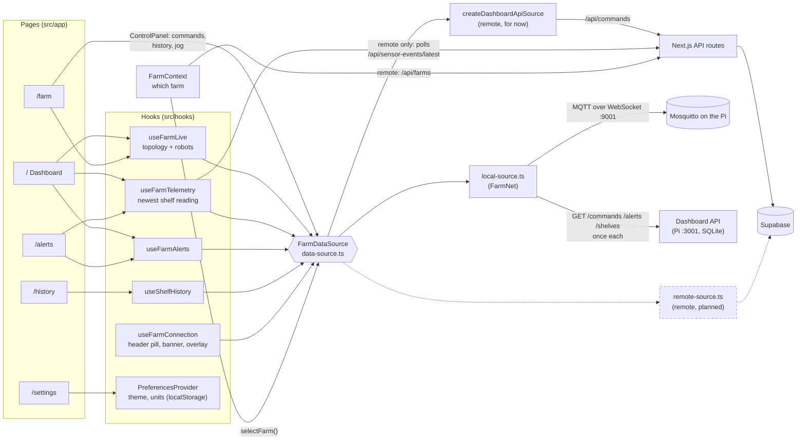
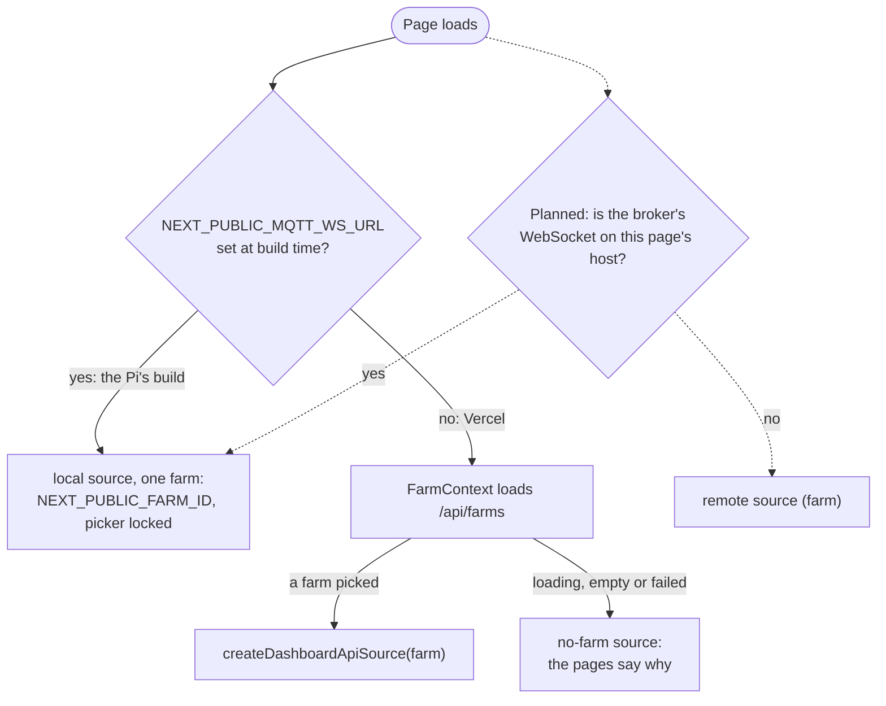
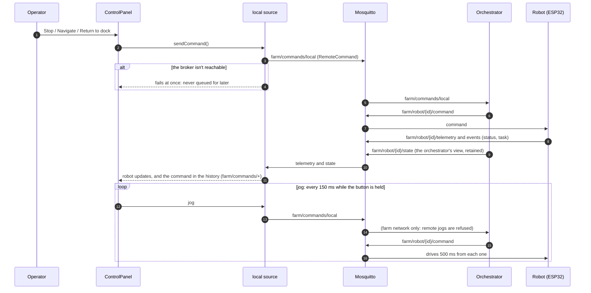
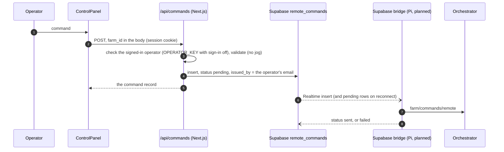
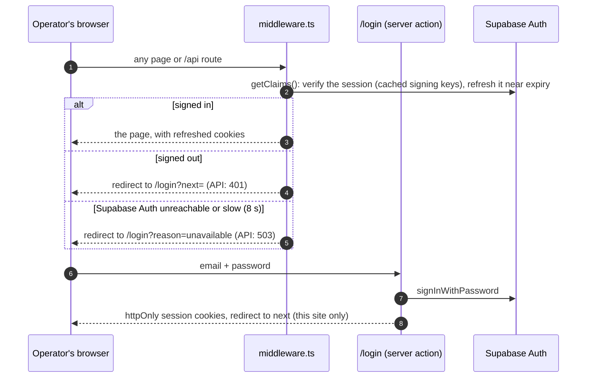

# Dashboard architecture

How the dashboard gets farm data and sends commands. Every page reads the
farm through one interface, `FarmDataSource` (`src/lib/farm/data-source.ts`),
so the UI is the same on the farm's WiFi (FarmNet) and on Vercel. Only the
source behind it changes.

Solid lines are built. Dashed lines are the remote source and the automatic
local/remote detection still to come (the dashboard data-flow task in
`docs/dev-team-timeline.html`), and the Supabase bridge they depend on.

## Components

- **On FarmNet** the local source reads everything live from the broker:
  `farm/robot/+/telemetry` and `farm/robot/+/state`, `farm/system/topology`,
  `farm/system/alert-thresholds`,
  `farm/shelf/+/sensors`, `farm/alerts` (and `farm/alerts/clear`), and every
  command on `farm/commands/+`. The Dashboard API fills in what happened
  before the page opened: recent commands per robot, the latest 500 alerts,
  and 7 days of shelf readings as 5-minute means.
- **Remotely, today** the stand-in source has no robots, the default map,
  no alerts and no history, and says "Remote access isn't available yet".
  It does send commands, through `/api/commands` into Supabase's
  `remote_commands`. Shelf readings bypass the source: `useFarmTelemetry`
  polls the farm's newest `sensor_events` row every 2 s.
- **Remotely, planned** `remote-source.ts` reads the same data from
  Supabase's tables and follows them through Realtime, and the polling goes.

## Picking the source

Swapping farms remotely swaps the whole source (`selectFarm()`), so every
hook resubscribes to the new farm.

## A command on FarmNet

## A command remotely

## Sign-in (remote only)

Operators sign in with Supabase Auth (email and password) everywhere but a
farm's Pi: the FarmNet build (`NEXT_PUBLIC_MQTT_WS_URL`) never asks, and never
calls Supabase Auth, so it works offline. `AUTH_DISABLED=true` turns sign-in off
elsewhere too (`signInRequired()` in `src/lib/auth.ts`). The password only
travels over HTTPS, to this app's server and on to Supabase Auth; the session
lives in httpOnly cookies that no browser script can read.

Each API route checks the session again itself (`getSession()`, `refuse()`).
Fails closed: without the Supabase URL and publishable key, or with Supabase
Auth down, only the login page loads, and it says why.

## Connection and loading

`subscribeConnection()` is the farm connection, never the browser's network:
on FarmNet, whether the broker answers; remotely (planned), whether the
farm's Supabase bridge is present on the `farm-status` channel. The header
pill, the offline banner and the loading overlay all follow it. A command
sent while it's offline fails rather than waiting, so a stop or jog can't
arrive late.
